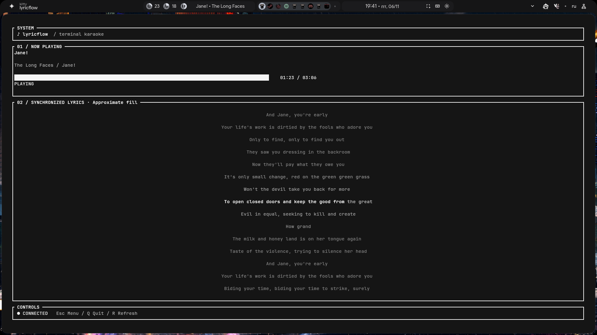

# lyricflow

Terminal karaoke for Spotify on Linux with synchronized lyrics, built with Rust, Ratatui,
Crossterm, Tokio and LRCLIB. Repository name: **lyricflow-spotify-linux**.

## Preview



## Features

- Progressive, Unicode-aware lyric highlighting.
- Local playback clock with pause/resume, seek handling and drift correction.
- Background Spotify polling and cancellable lyric requests.
- Standard LRC and Enhanced LRC parsing, including word timestamps when supplied.
- 17 themes, including transparent Pure White, and 14 interface languages.
- Persistent settings, manual lyric offset and optional Kitty font controls.

## Install

A current stable Rust toolchain is required. Tested on Linux x86_64 with Rust 1.99.1.
Install from source:

```sh
git clone https://github.com/L0rens/lyricflow-spotify-linux.git
cd lyricflow-spotify-linux
cargo install --path . --locked
```

Ensure the Cargo binary directory (`~/.cargo/bin`) is on your PATH. To replace an
existing Cargo installation, add `--force`. For development, use `cargo run --locked`.

## Connect Spotify

Create a Spotify developer application and configure this exact redirect URI:

```text
http://127.0.0.1:8888/callback
```

Set `LYRICFLOW_CLIENT_ID` to your application client ID, then run `lyricflow login`.
The application uses OAuth PKCE; a client secret is not required. Access depends
on your Spotify application's permissions and Spotify API availability.

In Fish, the client ID can be configured with:

```fish
set -Ux LYRICFLOW_CLIENT_ID YOUR_SPOTIFY_CLIENT_ID
lyricflow login
```

## Commands

| Command | Action |
| --- | --- |
| `lyricflow` | Start karaoke |
| `lyricflow login` | Connect Spotify using the browser |
| `lyricflow logout` | Remove local Spotify credentials |
| `lyricflow status` | Check the connection and show the current track |
| `lyricflow settings` | Open settings without connecting to Spotify |
| `lyricflow --help` | Show help |
| `lyricflow --version` | Show the version |

In karaoke, **Q** quits, **R** refreshes playback and retries missing lyrics, and
**Esc** opens settings. In the standalone settings command, **Esc** saves and exits;
**Q** exits. The menu also has explicit save and reset actions.

## Local data

Settings are stored in `~/.config/lyricflow/settings.json`; credentials are stored
in `~/.config/lyricflow/tokens.json`. Logout removes only the credential file and
keeps settings. It does not revoke the application's access on Spotify.

No user tokens, client IDs, personal settings or home-directory paths are
included in the source distribution.

## Timing accuracy

Standard LRC supplies line starts, not exact vocal or word endings. Its fill is
labeled **Approximate fill**. When a line has an unusually long interval before
the next one, its fill duration is estimated from the text lengths and timing of
nearby lines. This helps a short phrase finish filling before an instrumental
pause. The real line-change timestamp remains unchanged. Without enough nearby
data, the existing fallback caps estimated fill at eight seconds.

Valid Enhanced LRC supplies **Word timestamps**, which take precedence over the
estimate. A final word without an end marker activates at its start. Malformed
timing falls back to ordinary text. Simultaneous duet lines are not supported.
LRCLIB is not assumed to provide word-level timing for every song.

Spotify polling is not an audio clock. State changes are learned at the configured
refresh interval (1–30 seconds). Small discrepancies are corrected gradually;
large discrepancies, track changes and observed pause/resume events reanchor
the clock. Request midpoint compensation is estimated and capped at 500 ms.
Small seeks can be treated as drift. Manual Lyrics offset remains available.

## Appearance

Pure White preserves the terminal's background, including popup selections.
White is also available as a highlight in other themes. Kitty font controls
require a permitted Kitty remote-control interface and affect the whole terminal
window. Lyric spacing does not change the actual terminal font size.

## Development

```sh
cargo fmt --check
cargo check --locked
cargo test --locked
cargo clippy --all-targets --locked -- -D warnings
cargo build --locked
```

Tests exercise CLI parsing, logout isolation, playback clocks, LRC parsing,
Unicode, lyric fill, instrumental gaps, rendering, settings compatibility,
background requests and caching. Live Spotify alignment and Kitty font control
require checks on a configured desktop.

## License

[MIT](LICENSE).
