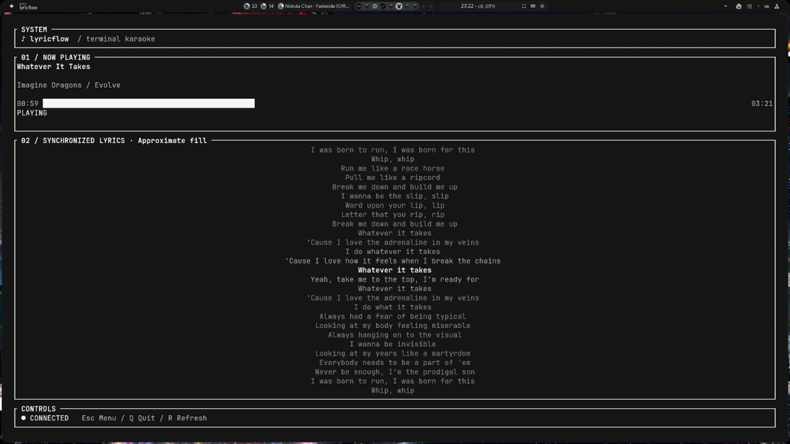

# lyricflow

Terminal karaoke for Spotify on Linux with synchronized lyrics, built with Rust, Ratatui,
Crossterm, Tokio and LRCLIB. Repository name: **lyricflow-spotify-linux**.

## Preview



## Features

- Progressive, Unicode-aware lyric highlighting.
- Local playback clock with pause/resume, seek handling and drift correction.
- Background Spotify polling and cancellable lyric requests.
- Standard LRC and Enhanced LRC parsing, including word timestamps when supplied.
- Local lyric caching and conservative fallback search after an exact lookup misses.
- Private diagnostic reports and offline demo playback.
- Multiple built-in color themes and configurable lyric highlighting.
- 14 interface languages, with English fallback for new messages where needed.
- Persistent settings, manual lyric offset and optional Kitty font controls.

## Install

Published binaries and SHA256 checksums are available on the
[Releases page](https://github.com/L0rens/lyricflow-spotify-linux/releases).
See each release for verification and installation instructions.

### Build from source

A current stable Rust toolchain is required. Tested on Linux x86_64 with Rust 1.99.1.
Install from source:

```sh
git clone https://github.com/L0rens/lyricflow-spotify-linux.git
cd lyricflow-spotify-linux
cargo install --path . --locked
```

Ensure the Cargo binary directory (`~/.cargo/bin`) is on your PATH. To replace an
existing Cargo installation, add `--force`. For development, use `cargo run --locked`.

## Connect Spotify

**Spotify Premium is required for Spotify mode.** The offline demo does not
require a Spotify account or subscription.

Create a Spotify developer application and configure this exact redirect URI:

```text
http://127.0.0.1:8888/callback
```

Set `LYRICFLOW_CLIENT_ID` to your application client ID, then run `lyricflow login`.
The application uses OAuth PKCE; a client secret is not required. Access depends
on your Spotify application's permissions and Spotify API availability.

In Fish, the client ID can be configured with:

```fish
set -Ux LYRICFLOW_CLIENT_ID YOUR_SPOTIFY_CLIENT_ID
lyricflow login
```

## Spotify API access and subscription requirements

Check Spotify's current [quota-mode requirements](https://developer.spotify.com/documentation/web-api/concepts/quota-modes)
for your developer application and the accounts allowed to use it, including any
Premium requirements. Requirements can differ by app mode and account role.
lyricflow does not provide subscription bypasses. HTTP 403 is not treated as
proof that the user's subscription is missing: app permissions and allowed-user
restrictions can also deny access.

## Connection and updates

The player-state endpoint distinguishes an explicitly missing/inactive Spotify
device from connected idle playback. An empty 204 response is shown as no
current playback; it is not claimed to prove that no device exists.

Authorization failures stop automatic retries and discard the failed client.
After logging in again, press **R** to reload saved credentials. Spotify rate
limits respect `Retry-After`, including when **R** is pressed. Temporary failures
use increasing retry delays. HTTP 403 is reported separately from authentication.

Update checks default to this repository. Set `LYRICFLOW_GITHUB_REPO=owner/repo`
only to override it for a fork. When no release exists yet, the checker reports
that neutrally; older releases are not announced as upgrades.

## Commands

| Command | Action |
| --- | --- |
| `lyricflow` | Start karaoke |
| `lyricflow login` | Connect Spotify using the browser |
| `lyricflow logout` | Remove local Spotify credentials |
| `lyricflow status` | Check the connection and show the current track |
| `lyricflow settings` | Open settings without connecting to Spotify |
| `lyricflow doctor` | Diagnose configuration and probe Spotify/LRCLIB |
| `lyricflow doctor --offline` | Local diagnostics without API requests |
| `lyricflow demo` | Play an original local sample without Spotify |
| `lyricflow demo --file example.lrc` | Preview a local standard/Enhanced LRC file |
| `lyricflow --help` | Show help |
| `lyricflow --version` | Show the version |

In karaoke, **Q** quits, **R** refreshes playback and retries missing lyrics, and
**Esc** opens settings. In the standalone settings command, **Esc** saves and exits;
**Q** exits. The menu also has explicit save and reset actions.

## Demo and diagnostics

`lyricflow demo` never connects to Spotify, LRCLIB or GitHub. Its original sample
uses an independent local playback clock. Space pauses, Left/Right seek by five
seconds, R restarts and Q exits. Esc opens the theme/settings preview; changes
made in demo are not saved to personal settings. Custom demo files must be UTF-8
LRC with at least one timestamped text line and at most 1 MiB.

`lyricflow doctor` reports configuration presence, client-ID presence, token-file
presence/permissions, Spotify/LRCLIB availability, terminal size and optional
Kitty remote control. It does not print tokens, client IDs, home paths, track
history or API response bodies. Online Spotify checks can refresh saved
credentials normally. Use `--offline` for local checks only; credential validity
is not established in that mode. Required failures exit with status 1; optional
terminal/Kitty warnings do not fail otherwise healthy checks.

## Local data

Settings and credentials use `$XDG_CONFIG_HOME/lyricflow/` when XDG_CONFIG_HOME is
an absolute path, falling back to `~/.config/lyricflow/`. The filenames remain
`settings.json` and `tokens.json`. Saves replace files atomically; credential
files use owner-only permissions on Unix. Invalid settings are preserved in a
`.bak` file before defaults are used. Existing backups are never overwritten.
Logout removes only the credential file and keeps settings. It does not revoke
the application's access on Spotify.

No user tokens, client IDs, personal settings or home-directory paths are
included in the source distribution.

### Lyrics cache and fallback search

Successful synchronized lyrics are stored under `$XDG_CACHE_HOME/lyricflow/lyrics/`
or `~/.cache/lyricflow/lyrics/`, keyed by a hash of the Spotify track identity.
Entries include a format version, track metadata, duration, LRCLIB source and
fetch time. They expire after 30 days and are ignored if corrupt, oversized,
from an unsupported version or inconsistent with the current track. Raw LRC is
parsed again on load. Cache write failures do not prevent lyric display.

If the exact LRCLIB lookup returns 404, search requires matching normalized
title and artist plus duration within two seconds or 2%, whichever is smaller.
An exact album is preferred; within that group the closest duration wins. Ambiguous equal-ranked
results with different lyrics are declined. Live/remastered titles and different
artists are not silently substituted. Missing or unsynchronized lyrics remain
reported honestly; there is no forced alignment or audio-stream analysis.

## Timing accuracy

Standard LRC supplies line starts, not exact vocal or word endings. Its fill is
labeled **Approximate fill**. When a line has an unusually long interval before
the next one, its fill duration is estimated from the text lengths and timing of
nearby lines. This helps a short phrase finish filling before an instrumental
pause. The real line-change timestamp remains unchanged. Without enough nearby
data, the existing fallback caps estimated fill at eight seconds.

Valid Enhanced LRC supplies **Word timestamps**, which take precedence over the
estimate. A final word without an end marker activates at its start. Malformed
timing falls back to ordinary text. Simultaneous duet lines are not supported.
LRCLIB is not assumed to provide word-level timing for every song.

Spotify polling is not an audio clock. State changes are learned at the configured
refresh interval (1–30 seconds). Small discrepancies are corrected gradually;
large discrepancies, track changes and observed pause/resume events reanchor
the clock. Request midpoint compensation is estimated and capped at 500 ms.
Small seeks can be treated as drift. Manual Lyrics offset remains available.

## Appearance

Themes preserve the terminal's default background. The selected lyric highlight
color works independently of the theme. Small terminals use a compact layout;
elapsed time, progress bar and duration have separate display areas. Kitty font controls
require a permitted Kitty remote-control interface and affect the whole terminal
window. Lyric spacing does not change the actual terminal font size.

## Development

```sh
cargo fmt --check
cargo check --locked
cargo test --locked
cargo clippy --all-targets --locked -- -D warnings
cargo build --locked
```

Tests exercise CLI parsing, logout isolation, playback clocks, LRC parsing,
Unicode, lyric fill, instrumental gaps, rendering, settings compatibility,
background requests and caching. Live Spotify alignment and Kitty font control
require checks on a configured desktop.

## Releases

[CHANGELOG.md](CHANGELOG.md) records versioned changes. CI uses Rust 1.99.1 for
formatting, type checks, tests, Clippy and builds. Version tags must match
Cargo.toml. The release workflow builds an x86_64 Linux archive, produces
SHA256SUMS, retains the build artifacts and publishes a GitHub Release. Hosted
binaries are built on Ubuntu 22.04 (glibc 2.35 baseline). Optional desktop
integrations and live Spotify account behavior still need desktop validation.

Maintainers can build the archive locally with `bash scripts/build-release.sh`.

## License

[MIT](LICENSE).
